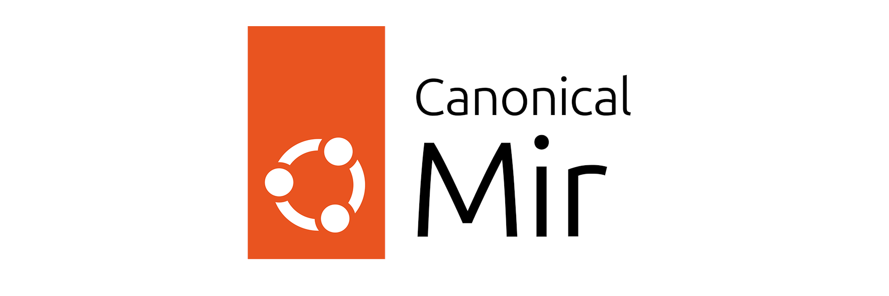

# Mir - Wayland compositor

**Mir** is a set of libraries for building Wayland based shells. Mir
simplifies the complexity that shell authors need to deal with: it
provides a stable, well tested and performant platform with touch,
mouse and tablet input, multi-display capability and secure
client-server communications.

Mir deals with the bringup and configuration of a broad array of
graphics and input hardware, abstracts hardware differences away
from shell authors (transparently dealing with hardware quirks) and
integrates with system components such as greeters.

Window management is integrated into Mir with useful default behaviour
and is extremely customisable by shell authors using a simple high-level
API.

## Resources

- For information on how to use Mir, refer to [the official documentation](https://canonical.com/mir/docs).
- For data sheets and whitepapers, check out [the Mir website](https://canonical.com/mir).
- Mir is [hosted on GitHub](https://github.com/canonical/mir).
- For announcements and other discussions on Mir see [Ubuntu Discourse/mir](https://discourse.ubuntu.com/c/mir/15) or join
  [the matrix channel](https://matrix.to/#/#mir-server:matrix.org) to get in touch with the team.

We aim for a public "Office Hours" every four weeks, where you can ask questions and get help.
The agenda is published in advance on [Ubuntu Discourse/mir](https://discourse.ubuntu.com/c/mir/15) and updated
afterward with notes and a link to the recording.

## Downstream projects

Mir is used in a range of downstream projects, including:

| Project                                                    | Summary                                                                                                                                                                                                                                                          |
| ---------------------------------------------------------- | ---------------------------------------------------------------------------------------------------------------------------------------------------------------------------------------------------------------------------------------------------------------- |
| [Miracle-wm](https://github.com/miracle-wm-org/miracle-wm) | "A hackable, stylish, and modern Wayland compositor built on Mir. It brings the keyboard-driven efficiency of i3/Sway to a richer, more extensible experience with smooth animations, a powerful WebAssembly plugin system, and a hot-reloadable configuration." |
| [Miriway](https://github.com/Miriway/Miriway)              | "Miriway is a generic compositor using Mir that can be customised to serve the needs of a range of desktop environments."                                                                                                                                        |
| [Lomiri](https://lomiri.org/)                              | "Same interface. Desktop. Tablet. Phone. Adapts to different screen sizes and input methods; seamless experience across devices"                                                                                                                                 |
| [Ubuntu Frame](https://snapcraft.io/ubuntu-frame)          | "The foundation for many embedded graphical display implementations."                                                                                                                                                                                            |

## Packaging status

## Copyright and License

Copyright © Canonical Ltd.

This program is free software: you can redistribute it and/or modify
it under the terms of the GNU General Public License version 2 or 3 as
published by the Free Software Foundation.

This program is distributed in the hope that it will be useful,
but WITHOUT ANY WARRANTY; without even the implied warranty of
MERCHANTABILITY or FITNESS FOR A PARTICULAR PURPOSE. See the
GNU General Public License for more details.

You should have received a copy of the GNU General Public License
along with this program. If not, see <http://www.gnu.org/licenses/>.
